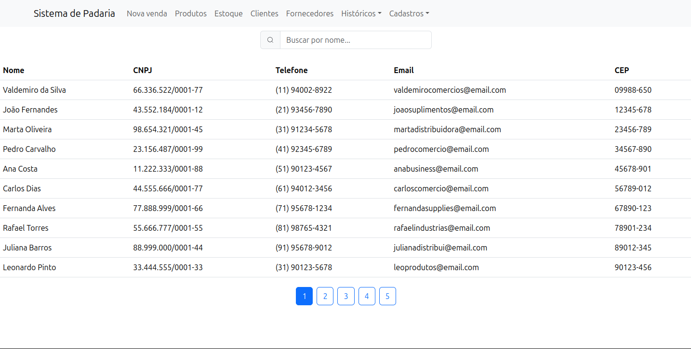
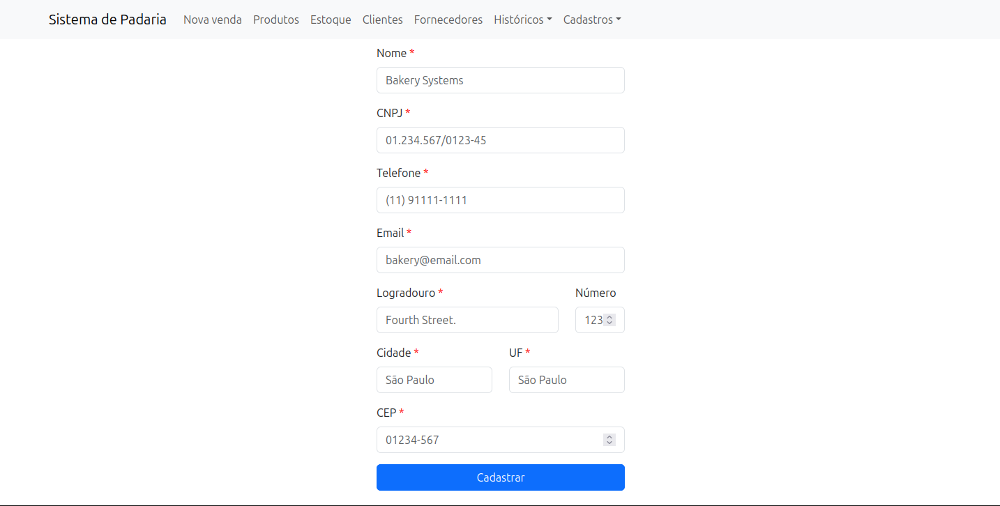

# Trabalho Prático
## Nome dos integrantes: 

- Gustavo Bastos de Souza - 14576642

- Gustavo Henriques Vieira - 14713982

- Kaique de Jesus Pessoa Santos - 14677144

- Renan Bezerra Guimarães - 14605640

## ✏️ Mini mundo: Padaria
Sistema de padaria que registra assinaturas de clientes (que permitem descontos no ato do pagamento) e seus dados de cadastro (Nome, CPF, Endereço, E-mail e Telefone). Ao realizar um pedido, o cliente escolhe um ou mais produtos, contendo suas informações (Valor, Quantidade e Nome), sendo esses produtos constituídos por ingredientes da receita do produto, que informa a quantidade necessária de tal produto em tal receita. Esses produtos também devem ter seus ingredientes disponíveis estocados, bem como é preciso saber suas informações (Nome, Valor, Validade, Marca e Quantidade). Um pedido do cliente contém um ou mais itens  de venda, e estes compõem uma venda, que possui suas próprias informações (Valor e Data da venda). Após a venda, o cliente paga por um meio que é registrado no sistema para aquela determinada venda.

## 📌 Funcionalidades:

🚩*Calcular descontos para clientes cadastrados: O cliente cadastrado ganha um desconto sobre o gasto total;*  

🚩*Gerar relatório de lucro geral e para cada produto;*

🚩*Gerar relatório de vendas e meios de pagamentos;*

🚩*Estimar quantos ingredientes estão disponíveis no estoque em um dado momento.*

🚩*Procurar quais os ingredientes estão próximos de vencer de acordo com o número de dias, semanas e meses.*

🚩*Procurar Igredientes vencidos.*

🚩*Procurar produtos restantes no estoque.*

## ✏️ Requisito de dados: 
Uma padaria quer construir um sistema para armazenar informações pertinentes para melhorar os processos do negócio e a lucratividade. O cliente cadastrado no sistema da padaria possui o atributo de CPF como principal identificador, além do seu nome, número de telefone, e-mail e a informação composta de seu endereço. Esse cliente compra um produto, que possui um identificador único, nome, valor unitário e quantidade disponível nas prateleiras do estabelecimento. O produto consome os ingredientes estocados, dados por um identificador único, nome, quantidade disponível, valor unitário, validade e marca. O produto é constituído por ingredientes de uma receita, com a quantidade de cada produto. O cliente então realiza um pagamento, caracterizado pelo seu formato, e esse pagamento é com base no valor de uma venda. Uma venda possui um identificador único, valor total e data de processamento da venda. A venda é constituída por um item de venda, gerado com base no produto.

## Exemplo de Telas:

### Listagem de Fornecedores

### Cadastro de Fornecedores

## Tutorial para uso:
<ul>
<li>Acessar o diretório <i>./sistema-de-padaria/src</i>, ou onde o arquivo <i>docker-compose.yaml</i> está presente</li>
<li>Definir portas e acesso ao banco de dados em um arquivo <i>.env</i>, como na estrutura do arquivo <i>.env.example</i></li>
<li>Com o docker instalado, digitar: <i>docker compose up -d --build</i></li>
<li>Acessar <i>http://localhost:3000/</i></li>
</ul>

## GETs e POSTs:
<ul>
<li>cliente [GET]</li>
<li>fornecedor [GET]</li>
<li>ingrediente [GET][POST]</li>
<li>pagamento [GET][POST]</li>
<li>produto-constituido-ingrediente [GET][POST]</li>
<li>produto [GET][POST]</li>
<li>venda [GET][POST]</li>
<li>desconto-cliente [GET]</li>
<li>estoque-atual-ingrediente [GET]</li>
<li>lucro-geral-venda [GET]</li>
<li> lucro-por-produto [GET]</li>
<li>meio-pagamento [GET]</li>
<li>produtos-restantes [GET]</li>
<li>ingrediente-proximo-expirar?format=&days= [GET] - format = {days, weeks, months} e number={1,2,3,4,...}</li>
<li>ingrediente-vencido [GET]</li>
<li>lucro-determinado-periodo?begin=&end= [GET] - begin e end devem ter valores na conveção java.sql.Date: yyyy-mm-dd</li>
</ul>

